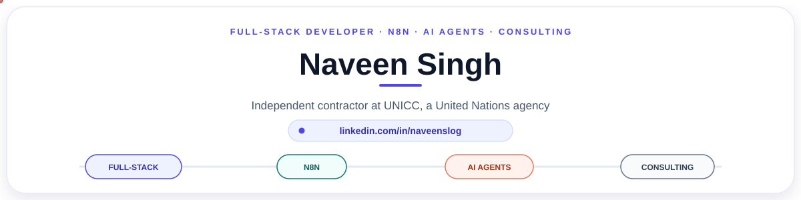
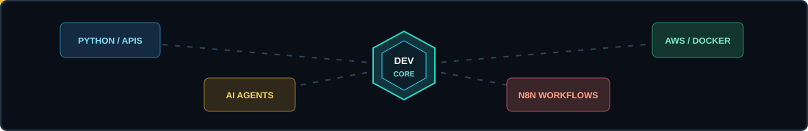
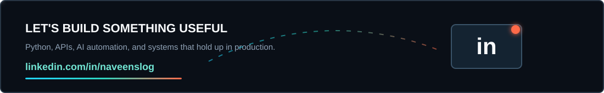

<!--
  PROFILE README
  Publish this from https://github.com/naveenslog/naveenslog
  to display it on the GitHub profile Overview page.
-->

  &nbsp;
  &nbsp;
  

  
  

## Building useful systems

I am Naveen Singh, a full-stack developer based in Delhi NCR. I have 12+ years in IT and 7+ years with Python. I work as an independent contractor at UNICC, a United Nations agency, and have worked on systems for UNHCR, UNICEF, UNFPA and WFP.

I also take on Python, API and AI-automation work: LLM agents, n8n agentic workflows, and open-source solutions and consulting.

### What I take on

- Backend systems in Python, Django and FastAPI that stay maintainable in production.
- AI automation and agents that use tools and finish the job, not demos that stop at a prompt.
- n8n agentic workflows, plus practical open-source solutions and consulting.

## Core practice

| Area | How I apply it |
| :--- | :--- |
| **Python backends** | Django, FastAPI, PostgreSQL, and APIs designed to be operated, not just launched. |
| **AI automation and agents** | Tool-using LLM agents and automation that plug into real business workflows. |
| **n8n workflows** | Agentic n8n orchestration for reliable, repeatable operations. |
| **Open-source consulting** | Practical, maintainable solutions built on open-source tools rather than throwaway prototypes. |
| **Delivery** | React on the front end, with Docker, AWS and the surrounding engineering that gets work shipped. |

## Selected work

  

| Work | Focus | Explore |
| :--- | :--- | :---: |
| **Claude Talking Avatar** | A Claude Code skill that turns a photo and a voice-over into a lip-synced cartoon talking-head video. | [Repository](https://github.com/naveenslog/claude-talking-avatar) |
| **Automation map** | A free map for spotting work that is worth automating. | [Open the map](https://cognifydigital.in/automation-map) |

## Tools I reach for

 

  

## Live engineering signal

 

## Let's work together

If you have a system to automate, an API to build, or an agentic workflow to get into production, I would like to hear about it.

  &nbsp;
  &nbsp;
  

