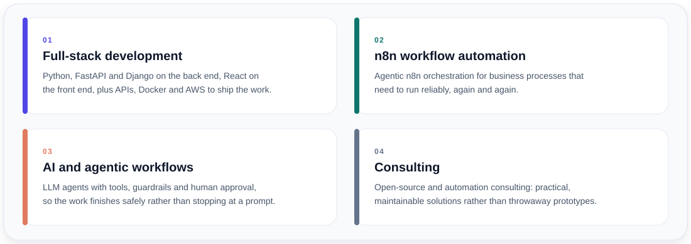
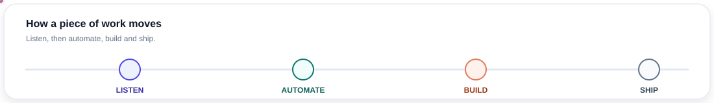

<!--
  PROFILE README
  Publish this from https://github.com/naveenslog/naveenslog
  to display it on the GitHub profile Overview page.
-->

  &nbsp;
  &nbsp;
  

  
  

## About

I'm Naveen Singh, a full-stack developer in Delhi NCR, with more than twelve years in IT and seven years writing Python. As an independent contractor at UNICC — a United Nations agency — I have worked on systems used by UNHCR, UNICEF, UNFPA and WFP.

My work sits in four areas: full-stack development, n8n workflow automation, AI and agentic workflows, and consulting.

## How I work

  

## Selected work

  

| Work | Focus | Explore |
| :--- | :--- | :---: |
| **Claude Talking Avatar** | A Claude Code skill that turns a photo and a voice-over into a lip-synced cartoon talking-head video. | [Repository](https://github.com/naveenslog/claude-talking-avatar) |
| **Automation map** | A free map for spotting work that is worth automating. | [Open the map](https://cognifydigital.in/automation-map) |

## Toolkit

 

  

## On GitHub

 

## Get in touch

If you need full-stack help, an n8n workflow, an AI agent with proper guardrails, or a consulting brief, send me a note on LinkedIn.

  &nbsp;
  &nbsp;
  

